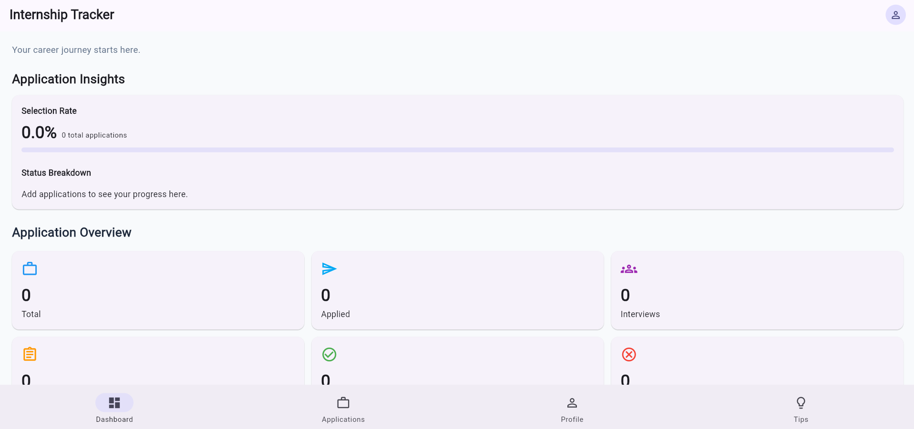
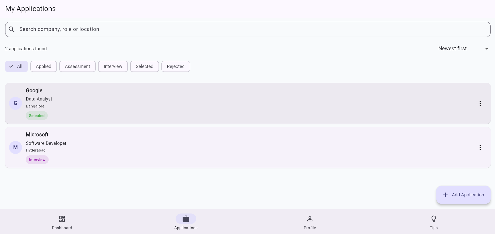
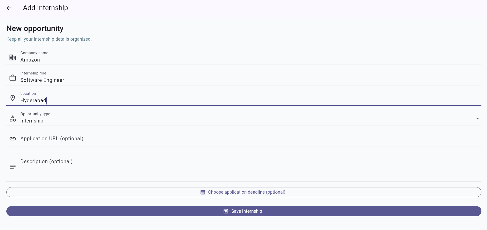
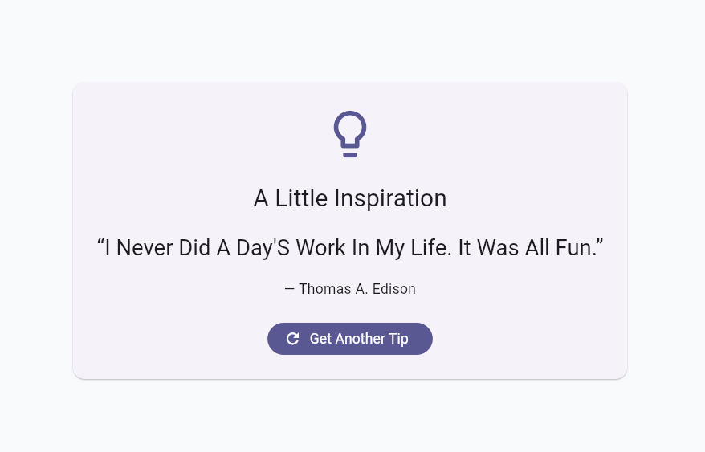
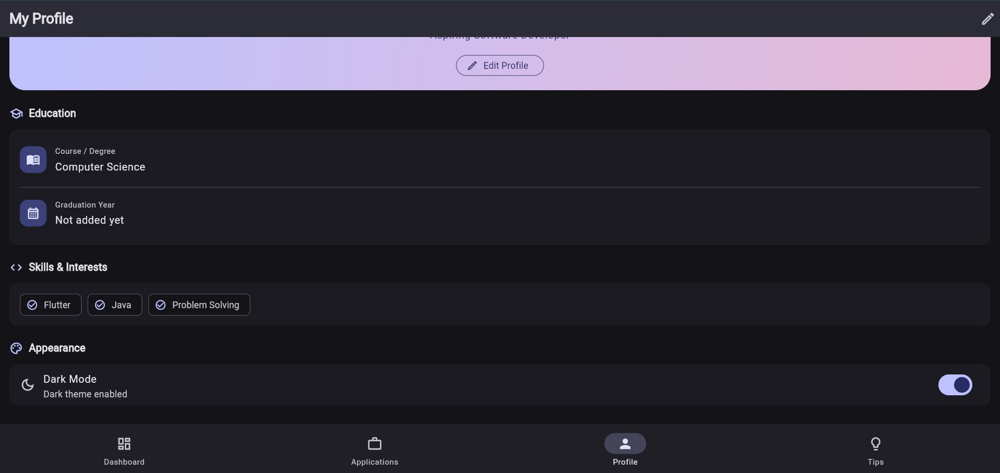

# Internship Tracker 🚀

A Flutter-based Internship Tracker application that helps students organize internship applications, track application statuses, manage deadlines, and monitor their career progress in one place.

**Live Demo:** [Open Internship Tracker](https://thagaramvamshi.github.io/internship_tracker/)

## ✨ Features

- **Dashboard Overview:** View total applications and application status counts.
- **Application Management:** Add, edit, view, and delete internship applications.
- **Status Tracking:** Track applications as Applied, Assessment, Interview, Selected, or Rejected.
- **Search and Filtering:** Find applications using relevant details and filter application lists.
- **Deadline Management:** View upcoming deadlines and overdue applications.
- **Application Insights:** Monitor selection rate and status breakdowns.
- **Career Tips:** Fetch inspirational career quotes from a REST API and refresh to get another tip.
- **Student Profile:** Manage student profile information.
- **Light and Dark Themes:** Switch between visual themes.
- **Local Persistence:** Save internship applications and relevant preferences using SharedPreferences.
- **Responsive Interface:** Adapt the dashboard layout to different screen widths.
- **Animated Dashboard Cards:** Display application statistics with staggered animations.

## 🛠️ Tech Stack

- **Framework:** Flutter
- **Language:** Dart
- **State Management:** Provider
- **Networking:** HTTP package
- **Local Storage:** SharedPreferences
- **API:** DummyJSON Quotes API
- **Testing:** Flutter unit tests and widget tests
- **Version Control:** Git and GitHub

## 📂 Project Structure

```text
internship_tracker/
├── dart_basics/
│   └── dart_basics.dart
├── lib/
│   ├── models/
│   ├── providers/
│   ├── screens/
│   ├── services/
│   ├── widgets/
│   └── main.dart
├── test/
│   ├── internship_provider_test.dart
│   └── widget_test.dart
├── web/
├── pubspec.yaml
└── README.md
```

## 🚀 Getting Started

### Prerequisites

- Flutter SDK
- Dart SDK (included with Flutter)
- Visual Studio Code or another compatible IDE
- Chrome, for running the web application locally

### Installation

1. Clone the repository:

   ```bash
   git clone https://github.com/thagaramvamshi/internship_tracker.git
   ```

2. Navigate to the project directory:

   ```bash
   cd internship_tracker
   ```

3. Install dependencies:

   ```bash
   flutter pub get
   ```

4. Run the application:

   ```bash
   flutter run -d chrome
   ```

## 🧪 Running Tests

Run the test suite with:

```bash
flutter test
```

Analyze the project with:

```bash
flutter analyze
```

The Dart basics demonstration can be run separately:

```bash
dart run dart_basics/dart_basics.dart
```

## 🌐 REST API Integration

The Career Tips screen uses the DummyJSON Quotes API to retrieve a random quote and author. It displays loading and error states and allows users to retry failed requests or fetch another quote.

API endpoint: `https://dummyjson.com/quotes/random`

An internet connection is required to fetch new quotes.

## 📸 Screenshots

Screenshots of the application can be added here.

### Dashboard


### Applications


### Add Application


### Career Tips


### Dark Theme


## 🎯 Purpose

This project demonstrates Flutter application development concepts, including reusable widgets, responsive layouts, navigation, state management, form validation, animations, REST API integration, local persistence, and automated testing.

## 👨‍💻 Author

**Vamshi**

GitHub: [thagaramvamshi](https://github.com/thagaramvamshi)

---

Built with Flutter and Dart.
